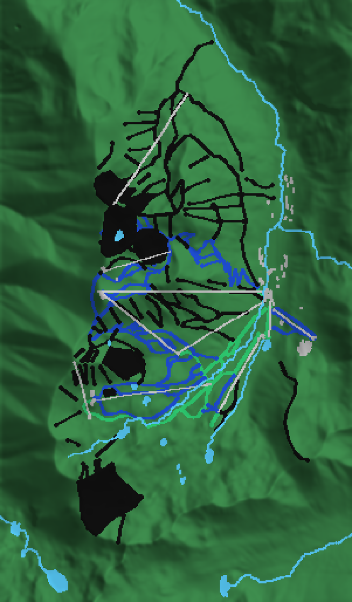
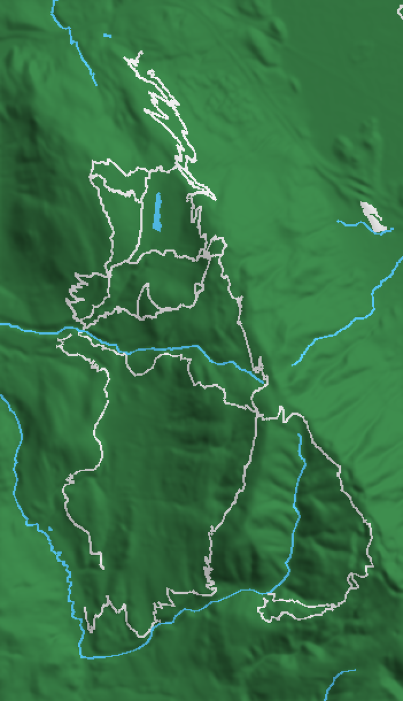

# trailprint

Generate 3D-printable terrain models of ski areas and mountain-bike trail systems from free,
open data: elevation from the AWS Open Data Terrarium tiles (USGS 3DEP / SRTM) and runs, lifts,
trails, water and buildings from OpenStreetMap.

The output is designed for multi-material printing (Bambu AMS, Prusa MMU) in the style of the
little desk-sized ski-hill models that go around r/3Dprinting: a green mountain with white runs,
grey lift lines, blue creeks, grey base-area buildings and the area name embossed on the front
of the base. Single-extruder modes (embossed or engraved relief) are also available.

```
out/crystal-mountain/
├── crystal-mountain-terrain.stl          # the mountain + base slab (green)
├── crystal-mountain-runs-easy.stl        # one STL per feature layer, each a watertight solid
├── crystal-mountain-runs-intermediate.stl
├── crystal-mountain-runs-advanced.stl
├── crystal-mountain-lifts.stl
├── crystal-mountain-water.stl
├── crystal-mountain-buildings.stl
├── crystal-mountain-label.stl            # "Crystal Mountain, WA" on the south face
├── crystal-mountain.3mf                  # all of the above as parts of one object
├── crystal-mountain-preview.png          # hillshade preview with layers coloured
└── crystal-mountain-stats.json
```

## Quick start

```bash
uv sync --all-extras
uv run trailprint info  areas/crystal-mountain.yaml   # grid / scale plan, no network
uv run trailprint preview areas/raging-river.yaml     # fetch data, write only the PNG
uv run trailprint build areas/crystal-mountain.yaml   # everything, into out/<slug>/
```

Tiles and Overpass responses are cached under `~/.cache/trailprint/` so re-running a build after
tweaking the YAML is fast. Pass `--cache DIR` to move it.

Overrides without editing the YAML: `--width 180 --resolution 0.3 --z-scale 1.5 --mode emboss`.

## Printing

**Multi-colour (`mode: parts`).** Open the `.3mf` in Bambu Studio / OrcaSlicer / PrusaSlicer. It
loads as a single object with one part per layer; assign a filament to each part. Feature parts
are embedded `embed_mm` into the terrain and stand `raise_mm` above it, so overlaps are
intentional. If you import the STLs instead, say *yes* when asked to load them as one object
with multiple parts.

**Single colour.** `--mode emboss` raises every feature by its `relief_mm`; `--mode engrave`
sinks them. Paint the recesses or run a paint-fill afterwards. `--mode plain` gives bare terrain.

Print flat, 0.12–0.16 mm layers, no supports. A 120 mm model at 0.4 mm grid resolution gives a
~0.4 mm feature resolution, which is about the limit of a 0.4 mm nozzle anyway.

## Defining an area

Copy one of the files in `areas/` and edit:

```yaml
name: Crystal Mountain
slug: crystal-mountain
bbox: { south: 46.896, west: -121.526, north: 46.966, east: -121.460 }

model:
  width_mm: 120        # east-west footprint; the north-south size follows the bbox
  resolution_mm: 0.4   # grid cell on the model; 0.3–0.5 is sensible
  base_mm: 7           # slab thickness below the lowest point (the label lives here)
  z_scale: 1.25        # vertical exaggeration; 1.0 is true scale
  smooth_mm: 0.5       # gaussian blur radius on the heightmap, 0 to disable
  mode: parts          # parts | emboss | engrave | plain

label: { text: "Crystal Mountain, WA", height_mm: 4, depth_mm: 0.6, side: south }

layers:
  - name: lifts
    select: ['["aerialway"~"^(chair_lift|gondola)$"]']   # Overpass tag selectors on `way`
    width_mm: 0.9      # drawn line width on the model
    raise_mm: 0.8      # top of the part above the terrain surface
    embed_mm: 0.8      # bottom of the part below the terrain surface
    relief_mm: 0.4     # used by emboss / engrave modes instead
    fill_closed: false # fill closed ways as areas (bowls, lakes, buildings)
    color: "#d0d0d0"   # preview colour only
```

Each `select` entry is appended to `way` in an Overpass query, so anything the
[Overpass QL](https://wiki.openstreetmap.org/wiki/Overpass_API/Overpass_QL) tag filter syntax
allows works. Useful tags:

| Feature | Selector |
| --- | --- |
| Ski runs by difficulty | `["piste:type"="downhill"]["piste:difficulty"="intermediate"]` |
| Lifts | `["aerialway"~"^(chair_lift|gondola|cable_car|t-bar|platter|rope_tow|magic_carpet)$"]` |
| MTB singletrack | `["highway"~"^(path|cycleway)$"]["mtb:scale"]`, `[...]["bicycle"="designated"]` |
| Forest roads | `["highway"="track"]` |
| Creeks and lakes | `["waterway"~"^(river|stream)$"]`, `["natural"="water"]` |
| Buildings | `["building"]` |

Use `trailprint preview` to check the bbox and tag coverage before committing to a build; OSM
coverage of ski runs and MTB trails varies a lot between areas. Only `way` elements are fetched;
multipolygon relations (large lakes) and `route=mtb` relations are not expanded yet.

## Bundled areas

| Area | Type | Notes |
| --- | --- | --- |
| `areas/crystal-mountain.yaml` | Ski (Crystal Mountain, WA) | Runs split green/blue/black, lifts, named creeks, base buildings |
| `areas/raging-river.yaml` | MTB (Raging River State Forest, WA) | DNR singletrack, the Raging River; forest roads available as a layer |

<p>


</p>

## How it works

1. The bbox is projected to Web Mercator and gridded at `resolution_mm` per cell. Mercator is
   conformal, so the footprint shape is right; the true ground scale is recovered with
   cos(latitude) when converting elevation to millimetres.
2. Terrarium PNG tiles are fetched at the zoom whose ground resolution matches the grid cell,
   mosaicked, bilinearly resampled onto the grid and optionally smoothed.
3. Each layer's ways are rasterised onto the grid as a boolean node mask (Pillow line drawing).
4. `mesh.heightfield_solid(top, bottom, mask)` builds a watertight solid from any masked
   heightfield: top faces, bottom faces and walls on the mask boundary. The terrain is the full
   mask with a flat bottom; each feature is `terrain ± offsets` over its mask; the label is the
   same routine run on a rendered text bitmap and rotated onto the chosen face.
5. Everything is exported as binary STL plus a multi-part 3MF via trimesh.

## Data credits

Elevation: [Terrain Tiles on AWS Open Data](https://registry.opendata.aws/terrain-tiles/)
(Mapzen/Tilezen Joerd; USGS 3DEP, SRTM, and others). Features: © OpenStreetMap contributors,
ODbL, via the public Overpass API. Please be polite to Overpass: builds are cached, but don't
hammer it in a loop.

## Development

```bash
uv sync --all-extras
uv run ruff check .
uv run pytest
```

Tests run entirely offline against synthetic DEMs and ways.

## License

MIT.
